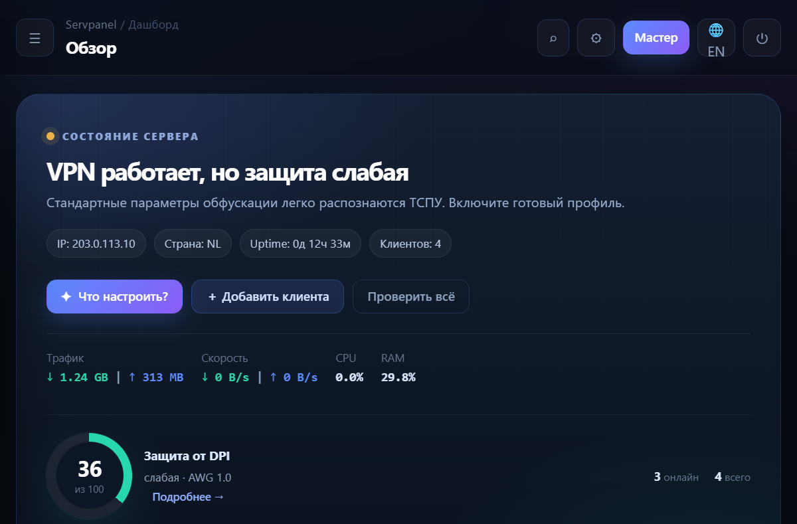
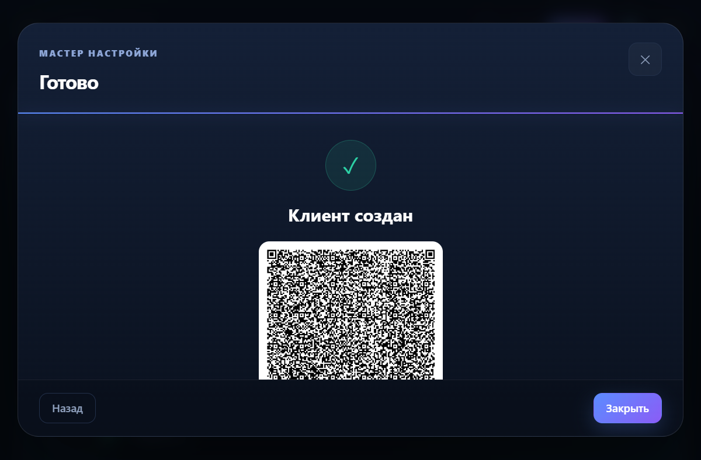
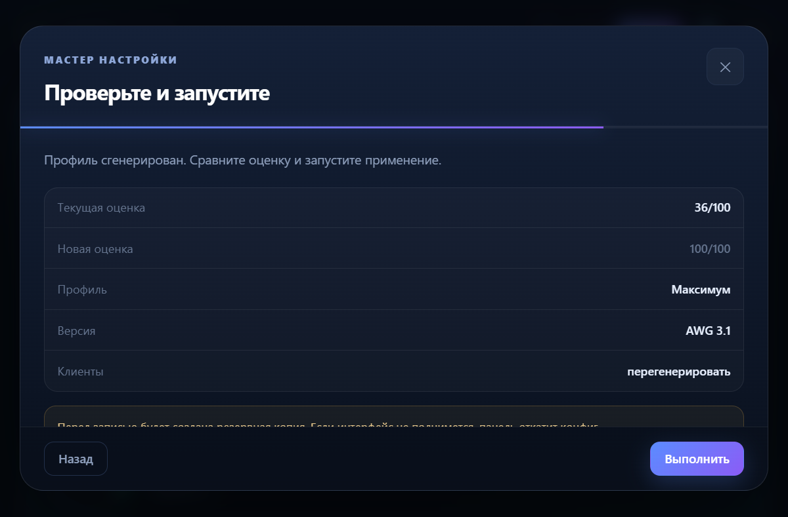
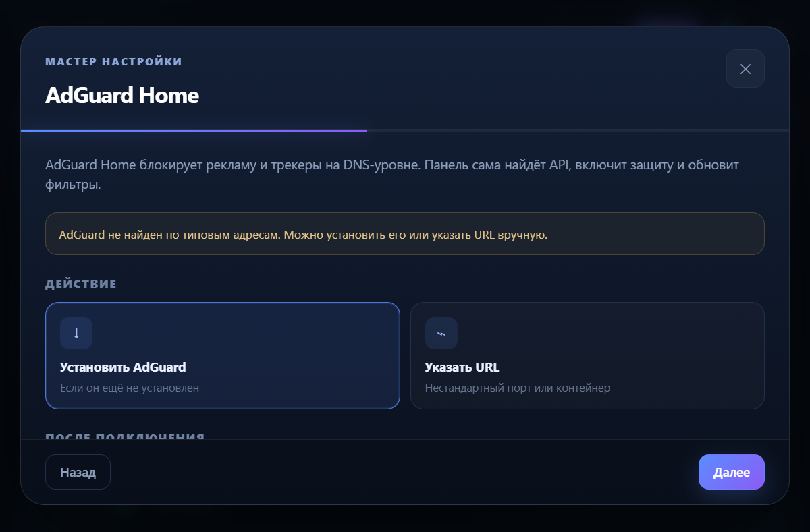
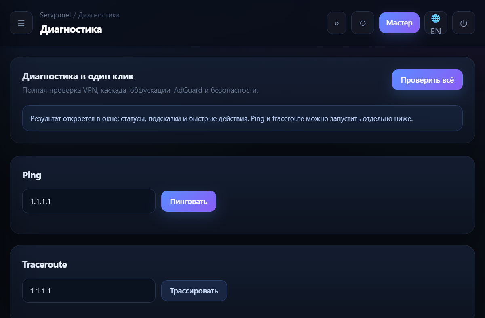
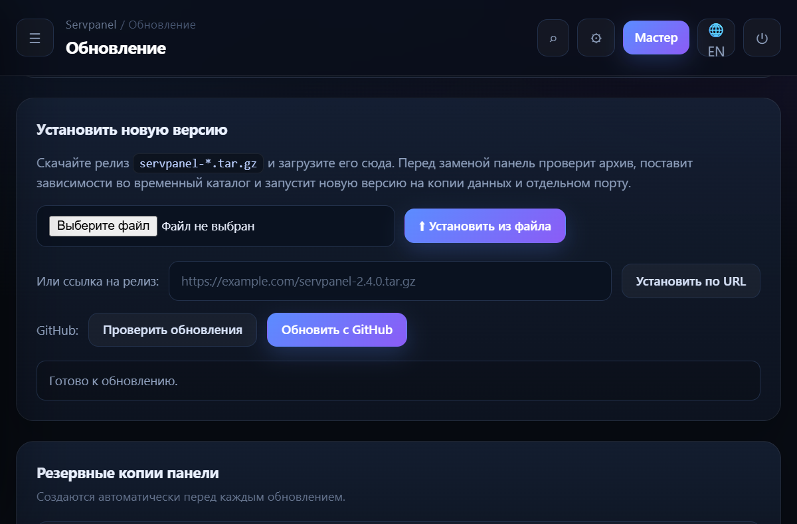

# Демонстрация Servpanel 2.4: мастеры, клиенты, обфускация, диагностика и обновление

Этот файл показывает, как выглядит и работает панель после переработки
интерфейса. Скриншоты сняты с локального демо-сервера
(`SERVPANEL_DEMO=1`): он не вызывает `sudo`, `systemctl`, `manage_amneziawg.sh`
и не меняет настройки реального VPN.

## 1. Дашборд: состояние сервера вместо таблицы полей



На первом экране сразу видно главное:

* работает ли VPN и какая оценка защиты от DPI;
* IP, страну, uptime и число клиентов;
* сумму трафика, текущую скорость, CPU и RAM;
* три кнопки-сценария: **«Что настроить?»**, **«Добавить клиента»**,
  **«Проверить всё»**.

Если защита слабая, панель не заставляет искать параметры вручную, а
предлагает готовый профиль. Экспертные поля и ручные редакторы скрыты в
обычном режиме — их можно включить переключателем **⚙**.

## 2. Добавление клиента: имя → устройство → готовый QR



Сценарий **«Добавить клиента»**:

1. Панель предлагает имя (его можно изменить), срок действия и количество
   клиентов.
2. Создаёт клиента через `/api/create`.
3. Сразу запрашивает `/api/clients/:name/key` и показывает QR, ссылку
   `vpn://`, кнопки **«Скачать .conf»** и **«Инструкция»**.
4. Ничего не нужно скачивать, распаковывать и искать вручную: ключ и QR
   появляются в том же окне.

Массовое создание (`2–20` клиентов) и переименование остались, но вынесены
в экспертный режим.

## 3. Обфускация: готовый профиль вместо десятков полей



Мастер предлагает три профиля:

| Профиль | Что делает |
|---|---|
| **Максимум** | AWG 3.1, случайные диапазоны `H1–H4`, `S1–S4`, `Jc/Jmin/Jmax`, `HeaderProtectionKey`, цепочки `I1–I5`, таймеры |
| **Баланс** | AWG 3.1, три CPS-цепочки, меньше нагрузки на слабые устройства |
| **Совместимость** | AWG 2.0, без `HeaderProtectionKey`, для старых клиентов и роутеров |

Перед применением показывается сравнение оценок (например, `36/100 →
100/100`), версия AWG и будет ли перегенерация клиентов. Профиль
генерируется на сервере (`POST /api/obf/generate`), а не собирается в
браузере.

При применении панель:

* делает резервную копию `awg0.conf.bak_<timestamp>`;
* заменяет только параметры обфускации в `[Interface]`;
* перезапускает `awg-quick@…` и проверяет `is-active`;
* при ошибке автоматически откатывает конфиг;
* при включённой перегенерации вызывает `manage_amneziawg.sh regen --json`.

Импорт `.conf` из сайта-Архитектора, JSON Amnezia и batch по-прежнему
доступен во вкладке **«Обфускация»** (экспертный режим).

## 4. AdGuard Home: автопоиск вместо ввода URL



Раньше нужно было вручную знать адрес API и порт. Теперь
`GET /api/adguard/autodetect` параллельно проверяет типовые адреса
(`127.0.0.1:8090`, `172.17.0.1:4443`, `127.0.0.1:4443`,
`127.0.0.1:3000`) и предлагает:

* **Подключить** найденный AdGuard;
* **Установить**, если его ещё нет;
* **Указать URL** для нестандартного порта или контейнера.

После подключения можно сразу включить защиту DNS и обновить списки
фильтрации.

## 5. Диагностика: проверка в один клик



Вкладка **«Диагностика»** теперь рабочая:

* **«Проверить всё»** — VPN, каскад, AdGuard, обфускация, безопасность и
  бэкапы; результат открывается списком с быстрыми действиями;
* **Ping** и **traceroute** — отдельные кнопки, без ручных команд;
* просмотр разрешённых логов (`awg`, `nginx`, `panel`) с обновлением.

## 6. Обновление: файл, URL, GitHub и откат



Вкладка **«Обновление»** показывает текущую версию, каталог, pm2-процесс,
порт, состояние Git, найденные интерфейсы каскада и список бэкапов. Установить
новую версию можно из файла `servpanel-*.tar.gz`, по URL или с GitHub.

Перед заменой фоновый процесс:

1. распаковывает релиз во временный каталог и проверяет файлы;
2. запускает новую версию на копии данных и отдельном порту;
3. делает бэкап панели и снимок системных конфигов;
4. заменяет только код, перезапускает `pm2` и проверяет HTTP;
5. при ошибке автоматически откатывается.

Данные, клиенты, пароль, 2FA, профили обфускации, сессии, конфиги AWG,
iptables/ipset, systemd-юниты каскада, nginx и AdGuard не изменяются.

## 7. Где ещё автоматизация

* **Установка AWG** — выбор роли сервера (один сервер / вход RU / выход EU)
  и сценария (мобильный, домашний, универсальный); версия, порт и профиль
  подставляются сами.
* **Каскад** — установка с нуля по SSH или настройка готового EU-конфига;
  прогресс и статус видны в интерфейсе.
* **Бэкап** — мастер спрашивает расписание и шифрование, затем запускает
  создание архива.
* **Полная проверка** — один сценарий вместо обхода пяти вкладок.
* **Командная палитра** — `Ctrl+K` (или кнопка поиска в верхней панели):
  быстрый переход к разделу или запуск мастера.
* **Экспертный режим** — переключатель **⚙** показывает ручные формы,
  массовое переименование, импорт из Архитектора и тонкие настройки.

## 8. Демо-режим

В демо-режиме сервер подменяет только системные вызовы:

* `/api/stats` и `/api/clients` возвращают несколько тестовых клиентов;
* `/api/interfaces` сообщает `awg0`, чтобы дашборд показывал рабочее
  состояние;
* `/api/create` создаёт демо-клиента в памяти и отдаёт валидный `.conf`;
* `/api/clients/:name/key` собирает `vpn://` и QR из демо-конфига;
* `/api/server-info` возвращает тестовые IP/домен/страну;
* история трафика заполняется тестовыми точками для графика.

Запуск локально:

```bash
SERVPANEL_DEMO=1 ADMIN_PASSWORD=demo SERVEPANEL_DATA_DIR=./demo-data \
  PANEL_PORT=3999 node server.js
```

Открыть `http://127.0.0.1:3999`, войти как `admin` с паролем `demo`.
Каталог `demo-data` создаётся автоматически; системные файлы не
затрагиваются.

## 9. Честные ограничения

* Оценка `100/100` — эвристика панели, а не гарантия обхода ТСПУ. При
  блокировке по IP обфускация не поможет.
* Диапазоны и CPS поддерживаются только клиентами AmneziaWG 3.0/3.1.
  Для старых клиентов используйте профиль **«Совместимость»** (AWG 2.0).
* Суммарная длина `I1–I5` ограничена 3200 символами.
* `S4` должен быть ≤ 32.
* Демо-режим не проверяет реальные `systemctl`, `sudo`, `awg` и
  `manage_amneziawg.sh` — только интерфейс и API.
* Скриншоты сняты при ширине окна 800 px, поэтому боковая панель в них
  свёрнута в кнопку **☰**. На десктопе она отображается постоянно.
